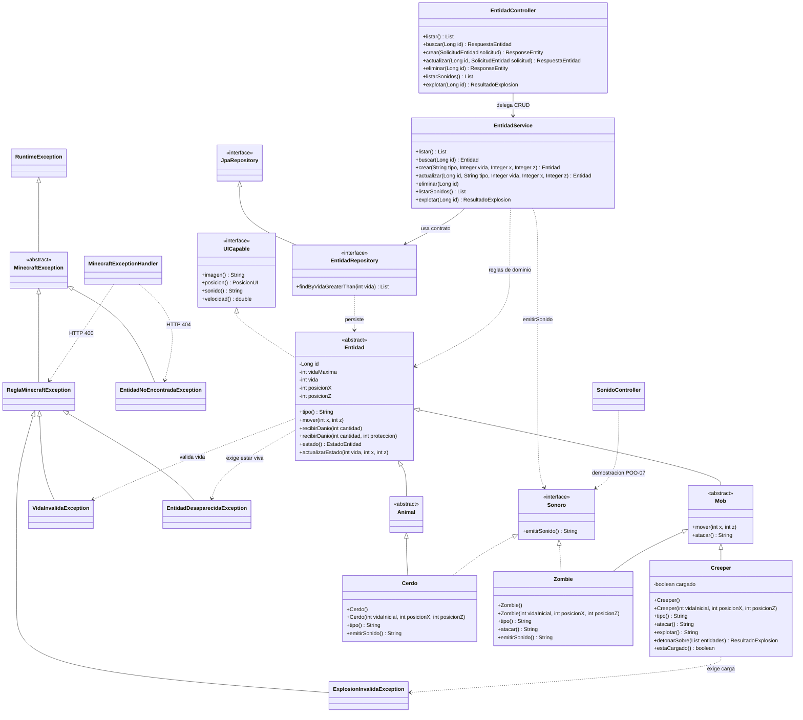

# MNRI Taller Git 2026

Proyecto de Marcelo Nicolas Romero Insfran (`mnri1904`) para la comision CYT646 F.

Trabajo practico POO-08: CRUD REST en tres capas, herencia persistida en H2 y
coleccion Insomnia, sobre el dominio Minecraft de POO-06 y POO-07.

## POO-08: guia rapida

Enunciado: [CRUD REST, H2 e Insomnia](https://github.com/alefq/afq-taller-git-2024/blob/main/docs/ejercicio-poo-08-crud-h2-insomnia-2026-10-28.md).

Con JDK 21, desde la raiz del proyecto:

```bash
./mvnw test
./mvnw spring-boot:run
```

La API escucha en `http://localhost:8080`. Insomnia se instala por separado
desde [insomnia.rest/download](https://insomnia.rest/download). No hace falta
instalar un servidor de base de datos: H2 corre dentro del proceso Java.

### Tres capas y recurso REST

El flujo del CRUD es `EntidadController → EntidadService → EntidadRepository`.
El controller traduce HTTP y DTOs; el service valida campos, selecciona el
subtipo y delimita transacciones; el repositorio accede a H2. Los constructores
y mensajes de `Entidad` conservan las reglas de vida. Ningun controller escribe
campos privados ni genera identificadores.

El sustantivo del recurso es **entidades**. La URL identifica una coleccion o
una entidad y el verbo expresa la operacion. `/api/crearCreeper` mezclaria la
accion con el recurso y obligaria a inventar URLs para cada operacion; esa ruta
no existe. Se crea un Creeper con POST y `"tipo":"Creeper"`.

| Metodo | URL | Resultado |
| --- | --- | --- |
| GET | `/` | `200`: confirma proyecto y dominio |
| POST | `/api/minecraft/entidades` | `201`: recurso con ID y cabecera `Location` |
| GET | `/api/minecraft/entidades` | `200`: arreglo de registros persistidos |
| GET | `/api/minecraft/entidades/{id}` | `200`: un recurso; `404` si no existe |
| PUT | `/api/minecraft/entidades/{id}` | `200`: estado actualizado; `404` si no existe |
| DELETE | `/api/minecraft/entidades/{id}` | `204` sin cuerpo; `404` si no existe |
| GET | `/api/minecraft/entidades/sonidos` | `200`: mensajes de entidades persistidas que implementan `Sonoro` |
| POST | `/api/minecraft/entidades/{id}/explosion` | `200`: detona un Creeper y persiste los daños |

POST y PUT reciben este JSON (en POST se omite `id`):

```json
{"tipo":"Zombie","vida":20,"posicionX":0,"posicionZ":0}
```

H2 genera `id` de tipo `Long` mediante `@GeneratedValue(IDENTITY)`. El cuerpo
de respuesta agrega `id`, `vidaMaxima` y `viva`. El ID no es la posicion en un
arreglo. No hay setters para ID ni para vida maxima.

### H2 y propiedades

La configuracion de `src/main/resources/application.properties` es para
desarrollo local:

| Propiedad | Valor | Motivo |
| --- | --- | --- |
| `spring.application.name` | `mnri-taller-git-2026` | Identifica el servicio Spring Boot. |
| `spring.datasource.url` | `jdbc:h2:file:./data/minecraft` | Guarda la base en archivo, relativo al directorio de ejecucion. |
| `spring.datasource.username` | `sa` | Usuario de conexion a H2. |
| `spring.datasource.password` | vacia | Contraseña de la base local de desarrollo. |
| `spring.jpa.hibernate.ddl-auto` | `update` | Crea las tablas si faltan y actualiza el esquema sin recrearlo en cada arranque. |
| `spring.jpa.open-in-view` | `false` | El acceso a la base ocurre dentro de las transacciones del service. |
| `spring.h2.console.enabled` | `true` | Habilita la consola web de H2 en este entorno de desarrollo. |
| `spring.h2.console.path` | `/h2-console` | Fija la ruta de la consola. |

Abrir <http://localhost:8080/h2-console>, usar la misma URL JDBC, usuario y
contraseña de la tabla, y ejecutar:

```sql
SELECT * FROM entidades;
```

La consulta muestra el ID, discriminador, vida y posicion guardados.
La base queda en `data/minecraft.mv.db` y no se
versiona. Detener y arrancar desde la misma carpeta conserva las filas.
Las pruebas usan H2 en memoria y `create-drop` en `src/test/resources/application.properties`;
sus datos desaparecen al finalizar y no afectan la base de desarrollo.

### Herencia, discriminacion y constructores

Se eligio `SINGLE_TABLE`: las entidades comparten ID, vida y posicion; una tabla
permite listar toda la familia sin joins. La columna discriminadora `tipo`
de `entidades` guarda `Zombie`, `Creeper` o `Cerdo`. `Mob` y `Animal` son bases
abstractas persistibles; `Creeper` y `Zombie` siguen siendo dos hijas distintas
de `Mob`, y `Cerdo` pertenece a `Animal`. `Entidad.tipo()` y `Mob.atacar()`
siguen siendo abstractos y las hijas conservan sus sobreescrituras.

En HTTP se eligio un campo explicito `tipo` en el DTO en lugar de deserializar
directamente la entidad con `@JsonTypeInfo`. El service acepta solo los tres
tipos conocidos (sin distinguir mayusculas, quitando espacios exteriores) y
llama a sus constructores; el JSON no puede elegir una clase Java arbitraria.

JPA accede a los campos privados porque `@Id` esta en un campo. Las bases
abstractas tienen constructor vacio **protected**, reservado para la
reconstruccion JPA; el de `Entidad` delega a un estado inicial legal de vida 1
que JPA reemplaza al hidratar. Las clases concretas mantienen sus constructores
publicos simples y sobrecargados con vida y posicion. Para permitir proxies de
JPA, las clases persistibles concretas ya no son `final`.

### Interfaz propia y repositorio

`EntidadRepository extends JpaRepository<Entidad, Long>` es una interfaz cuya
implementacion genera Spring Data. Declara ademas `findByVidaGreaterThan(int)`:
Spring Data construye la consulta de entidades vivas a partir de su nombre.
El controller depende de `EntidadService`, y este de la interfaz del repositorio,
sin conocer una clase concreta de SQL. Cambiar el acceso a datos no requiere
reescribir las operaciones HTTP. El principio coincide con POO-07: se pide un
mensaje de un contrato, sin depender de la implementacion concreta.

El endpoint `/api/minecraft/entidades/sonidos` consulta las filas vivas, selecciona
las que implementan `Sonoro` e invoca `emitirSonido()` mediante una referencia
de esa interfaz. Puede devolver juntos un `Zombie extends Mob` y un
`Cerdo extends Animal`. Un Creeper no implementa `Sonoro` y queda fuera; una
base vacia devuelve `[]`. Ejemplo (IDs ilustrativos):

```json
[
  {"id":1,"tipo":"Zombie","mensaje":"Grrr: el zombie gime buscando un objetivo."},
  {"id":2,"tipo":"Cerdo","mensaje":"Oink, oink: el cerdo gruñe tranquilamente."}
]
```

### Ocultamiento, actualizacion y borrado

- El service exige `tipo`, `vida`, `posicionX` y `posicionZ`; el tipo debe estar
  soportado y la vida ser positiva.
- Los constructores de dominio validan el maximo: 20 en Zombie/Creeper, 10 en
  Cerdo. `Entidad.actualizarEstado` aplica el mismo limite antes de modificar
  cualquiera de sus campos. No hay setters sin validacion.
- PUT reemplaza todos los campos editables (`tipo`, `vida`, `posicionX`,
  `posicionZ`); omitir uno o enviar `null` produce `400`, sin cambiar la fila.
  `tipo` debe coincidir con el existente: no se convierte un Zombie en Cerdo.
  ID y vida maxima no son editables. No se implementa PATCH.
- DELETE hace borrado fisico con `repository.delete`; no llama a `desaparecer()`.
  Desaparecer representa una entidad con vida cero en el juego; borrar el
  recurso significa quitar su registro de la base.
- Las excepciones propias devuelven `400` con `{"codigo":"CODIGO","error":"mensaje"}` y
  los IDs inexistentes devuelven `404`. Las transacciones evitan persistir
  actualizaciones incompletas. No se usa Bean Validation: las reglas estan
  explicitamente en el service y en el dominio.

El pedido 06 de Insomnia envia un Cerdo con vida 11: debe devolver `400`.
Repetir el GET de la coleccion antes y despues demuestra que no agrego una fila.

### Importar y recorrer Insomnia

1. Instalar y abrir Insomnia. Elegir **Import → File** y seleccionar
   [`insomnia/poo-08-minecraft.json`](insomnia/poo-08-minecraft.json).
2. Abrir la coleccion **MNRI POO-08 — Minecraft CRUD H2**. Su entorno contiene
   `base_url` (`http://localhost:8080`), `entidad_id`, `creeper_id`, `zombie_id`
   e `id_inexistente` (texto para no perder precision numerica).
   En **Insomnia Desktop 13.4.0 → Use local Scratch Pad**, los pedidos se
   importaron, pero las variables no se cargaron automaticamente. Si aparece
   el aviso de variable faltante, cancelar, presionar **Ctrl+E**, seleccionar
   **Base Environment** y agregar con **+ Add** estas filas:

   | Input Name | Input Value inicial | Tipo |
   | --- | --- | --- |
   | `base_url` | `http://localhost:8080` | Text |
   | `entidad_id` | ID del Zombie del pedido 02 | Text |
   | `creeper_id` | ID del Creeper del pedido 12 | Text |
   | `zombie_id` | ID del Zombie del pedido 13 | Text |
   | `id_inexistente` | `9223372036854775807` | Text |

   Agregar cada ID despues de recibir su respuesta de creacion, cerrar con
   **Close** y ejecutar con **Send**. No usar IDs de ejemplo como si fueran
   garantizados. Los pedidos en Scratch Pad son suficientes para este recorrido;
   no es necesario iniciar sesion. El JSON del export no es una especificacion
   OpenAPI: una advertencia en la pestaña Spec no implica un fallo del servicio.
3. Ejecutar **01** (GET vivo) y **02** (POST Zombie). Copiar el `id` de la
   respuesta al valor `entidad_id` del entorno; no asumir que sera 1.
4. Ejecutar **03** y **04** para listar y consultar lo creado; **05** para
   actualizar; repetir **04** y comprobar vida 15 y posicion (4, -2).
5. Antes de borrar, detener el proceso con Ctrl+C, arrancarlo otra vez desde
   la misma carpeta y repetir **04**: el estado actualizado debe continuar.
6. Ejecutar **06** (POST invalido, `400`) y repetir **03** para verificar que
   no crecio la coleccion.
7. Ejecutar **07** (crear Cerdo) y **08** (Sonoro). El arreglo incluye el Zombie
   y el Cerdo persistidos. No reemplazar `entidad_id` con el ID del Cerdo.
8. Ejecutar **09** (ID inexistente, `404`), **10** (DELETE Zombie, `204`) y
   **11** (GET del borrado, `404`). **12** permite crear tambien un Creeper.
9. Para la simulacion, copiar el ID del pedido **12** a `creeper_id`. Ejecutar
   **13** y **14** para crear un Zombie y un Cerdo cercanos; **15** detona al
   Creeper; **16** consulta su vida cero; **17** intenta repetir y recibe `400`;
   **18** lista el estado guardado. En una base con otros objetivos cercanos,
   la explosion tambien los afecta.
10. En el pedido **13**, copiar el ID del Zombie a `zombie_id`. Ejecutar **19**
    para intentar detonarlo (`400`, `EXPLOSION_INVALIDA`) y **20** para enviar
    datos incompletos (`400`, `REGLA_MINECRAFT_INVALIDA`).

Los cinco errores tienen un pedido propio y un codigo esperado:

| Pedido | HTTP | `codigo` esperado |
| --- | --- | --- |
| 06 | 400 | `VIDA_INVALIDA` |
| 09 | 404 | `ENTIDAD_NO_ENCONTRADA` |
| 17 (despues de 15) | 400 | `ENTIDAD_DESAPARECIDA` |
| 19 | 400 | `EXPLOSION_INVALIDA` |
| 20 | 400 | `REGLA_MINECRAFT_INVALIDA` |

Si ya se importo una version anterior, importar este archivo actualizado en
Insomnia y abrir la coleccion que muestre los **20 pedidos**.

Los pedidos se pueden repetir; cada POST valido agrega una fila nueva.
Para limpiar un registro extra, usar DELETE con su ID. La consola H2 permite
observar las filas antes y despues del recorrido.

### Cambio de motor y entrega

Para cambiar H2 por otra base relacional se modifica el driver en `pom.xml`,
las propiedades de conexion y la estrategia de esquema/migraciones; se revisa
la compatibilidad de generacion de IDs. Las reglas de dominio, la interfaz del
repositorio y los endpoints no dependen de SQL especifico de H2.

Las especificaciones para Classroom estan en
[`ENTREGA_POO_08_MNRI.md`](ENTREGA_POO_08_MNRI.md). La entrega se completa
con el enlace exacto al commit publicado y la prueba manual en Insomnia.
La consigna pide commits separados para dependencias/propiedades, entidades,
repositorio, controller CRUD, reglas y simulacion, excepciones y handlers,
coleccion y README; el historial debe registrar
esas unidades con mensajes descriptivos.

Verificacion realizada: 62 pruebas automatizadas aprobadas; los 18 pedidos
de la coleccion comprobados por HTTP contra Spring Boot real, incluyendo
persistencia en archivo despues de reiniciar. La importacion visual en Insomnia
13.4.0 y el recorrido manual de CRUD, protocolo, simulacion y los cinco codigos
de error ya se realizaron. Se confirmaron las filas en la consola H2.
El [registro de evidencias](docs/EVIDENCIAS_POO_08.md) resume las capturas
compartidas por el estudiante. Los cambios se registran en commits separados;
quedan pendientes la publicacion, el enlace exacto al commit publicado y el
envio a Classroom.

## Dos reglas de negocio: simulacion de explosiones

1. **Daño por proximidad:** la explosion de un Creeper descuenta vida a los
   Zombies y Cerdos vivos dentro de tres bloques, con daño decreciente segun
   la distancia y sin permitir vida negativa.
2. **Consumo del detonador:** el Creeper debe estar vivo y cargarse antes de
   explotar; al detonar desaparece y no puede repetir la explosion mientras
   permanezca desaparecido.

La primera regla esta en `Creeper.detonarSobre` y `Entidad.recibirDanio`; la
segunda en `Creeper.atacar`, `Creeper.explotar` y `Entidad.exigirActiva`.
Ambas se ejecutan en la misma simulacion, cambiando el estado del detonador y
de sus objetivos. No son validaciones inventadas por el controller.

Participan tres clases concretas: **Creeper** provoca la explosion y
**Zombie** y **Cerdo** reciben daño usando `Entidad.recibirDanio`. La simulacion
vive en `Creeper.detonarSobre`, no en el controller ni en el repositorio.

`POST /api/minecraft/entidades/{id}/explosion` no necesita cuerpo. El service
busca un Creeper persistido y consulta las entidades vivas. El dominio carga
al Creeper con `atacar()`, aplica los daños y llama a `explotar()`, conservando
la regla previa de que primero debe cargar. Se guarda todo en una transaccion
JPA: el Creeper queda con vida 0 y los objetivos conservan su vida resultante.
No se eliminan las filas y los otros Creepers no reciben daño ni se detonan
en cadena. Los objetivos que ya desaparecieron se omiten.

La distancia es euclidea en X/Z: `sqrt((xObjetivo-xCreeper)^2 + (zObjetivo-zCreeper)^2)`.
El radio es de 3 bloques, incluyendo el borde. Dentro del radio se calcula
`daño = 12 - 3 * floor(distancia)`:

| Distancia | Daño calculado |
| --- | --- |
| 0 a menos de 1 | 12 |
| 1 a menos de 2 | 9 |
| 2 a menos de 3 | 6 |
| Exactamente 3 | 3 |
| Mayor que 3 | 0 |

El daño aplicado que informa el JSON es la vida realmente descontada: si un
Cerdo tiene 5 puntos y recibe 6, pierde 5 y queda en 0, nunca negativo.
El resultado incluye `creeperId`, el estado final del `creeper`, `radio` y
`afectados`, con ID, tipo, distancia, daño aplicado y vida anterior/actual.
Sin objetivos cercanos, el Creeper igualmente explota y `afectados` es `[]`.

Ejemplo reproducible en Insomnia (pedidos 12–18): Creeper en (5,5), Zombie con
vida 20 en (6,5) y Cerdo con vida 10 en (7,5). Tras detonar, quedan con vidas
**0, 11 y 4**, respectivamente. Para ejecutar desde una terminal, sustituir
`ID_CREEPER` por el ID de creacion:

```bash
curl -X POST http://localhost:8080/api/minecraft/entidades/ID_CREEPER/explosion
```

Repetir la explosion de un Creeper desaparecido da `400` y no vuelve a dañar.
Un ID de Zombie o Cerdo da `400`; un ID inexistente da `404`.
Consultar cada entidad por GET permite verificar el cambio persistido.
Si el servidor ya estaba iniciado antes de agregar esta funcionalidad, detenerlo
con Ctrl+C y volver a ejecutar `./mvnw spring-boot:run` para cargar el nuevo codigo.

## Licencia

El proyecto se distribuye bajo [Apache License 2.0](LICENSE).

## Organizacion

```text
src/main/java/py/edu/uc/lp3/
├── MnriTallerGit2026Application.java
├── domain/
│   ├── Entidad.java
│   ├── exception/ (jerarquia de excepciones Minecraft)
│   ├── EstadoEntidad.java
│   ├── ResultadoExplosion.java
│   ├── Mob.java
│   ├── Animal.java
│   ├── Cerdo.java
│   ├── Sonoro.java
│   ├── UICapable.java
│   ├── PosicionUI.java
│   ├── Creeper.java
│   └── Zombie.java
├── repository/
│   └── EntidadRepository.java
├── service/
│   └── EntidadService.java
└── rest/controller/
    ├── EntidadController.java
    ├── IndexController.java
    ├── MobController.java
    ├── SonidoController.java
    ├── UIController.java
    └── RomeroMarceloController.java
```

El dominio contiene las reglas del juego. Los controllers reciben HTTP y
envian mensajes al dominio. La clase Application inicia Spring Boot.

## Ejecutar

Requisito: JDK 21. Se utiliza Maven Wrapper, por lo que no es necesario
instalar Maven por separado.

```bash
./mvnw spring-boot:run
```

La API queda disponible en `http://localhost:8080`.

## Endpoints de demostraciones anteriores (POO-06/07)

```text
GET /
GET /api/minecraft/mobs/creeper?vida=12&x=100&z=-50
GET /api/minecraft/mobs/zombie?vida=15&x=3&z=2
GET /api/minecraft/sonidos/cerdo
GET /api/minecraft/sonidos/zombie
GET /api/minecraft/ui/creeper
GET /api/minecraft/ui/zombie
GET /api/minecraft/ui/cerdo
```

El controller construye el mob indicado en la URL y lo usa mediante el tipo
padre `Mob`. El JSON resultante muestra el estado heredado y el comportamiento
sobreescrito por cada hija.

Los parametros `vida`, `x` y `z` alimentan el constructor. `x` y `z` son
obligatorios; si se omite `vida`, se utiliza 20. Cada peticion a este endpoint
crea una instancia nueva. La vida inicial debe estar entre 1 y 20 y se valida
en `Entidad`. Un valor invalido produce HTTP 400 con un JSON de error.

La posicion inicial es el lugar de aparicion, no un desplazamiento. Por eso
puede estar lejos del origen. El limite de ocho bloques se aplica al mensaje
`mover`, no al constructor.

## Capacidad compartida mediante interfaz

`domain/Sonoro.java` declara la capacidad de emitir un sonido como texto:

```java
public interface Sonoro {
    String emitirSonido();
}
```

La implementan dos clases de familias distintas: `Cerdo extends Animal` y
`Zombie extends Mob`. Cada clase define `emitirSonido()` con `@Override` y
exige estar viva, conservando las reglas de `Entidad`.

`SonidoController` construye el objeto y pide el mensaje mediante el tipo de
la interfaz, mostrando polimorfismo entre familias:

```java
Sonoro emisor = crearEmisor(tipoNormalizado);
return new RespuestaSonido(tipoNormalizado, emisor.emitirSonido());
```

Con la aplicacion iniciada:

```bash
curl http://localhost:8080/api/minecraft/sonidos/cerdo
curl http://localhost:8080/api/minecraft/sonidos/zombie
```

Las respuestas JSON son:

```json
{"tipo":"cerdo","mensaje":"Oink, oink: el cerdo gruñe tranquilamente."}
```

```json
{"tipo":"zombie","mensaje":"Grrr: el zombie gime buscando un objetivo."}
```

Cada peticion crea una instancia nueva. Un tipo no soportado devuelve HTTP 400
con un JSON de error. `Creeper` y `Zombie` siguen siendo de la misma familia
`Mob`; por eso la segunda implementacion de `Sonoro` es `Cerdo`.

## Elementos dibujables: UICapable

`Entidad implements UICapable`, por lo que todas las entidades concretas del
dominio (`Creeper`, `Zombie` y `Cerdo`) cumplen el contrato visual:

```java
public interface UICapable {
    String imagen();
    PosicionUI posicion();
    String sonido();
    double velocidad();
}
```

`imagen()` devuelve un identificador como `minecraft:zombie` para que la UI
lo asocie con su recurso visual. `posicion()` devuelve una copia inmutable de
las coordenadas actuales X/Z; ambos metodos se implementan en `Entidad`.
`sonido()` devuelve texto: Zombie y Cerdo delegan en `emitirSonido()`, y Creeper
devuelve silencio o siseo segun su estado de carga. La entidad debe estar viva
para emitir el sonido. `velocidad()` devuelve el atributo de movimiento del
modelo: 0.23 para Zombie y 0.25 para Creeper y Cerdo; no cambia las reglas de
desplazamiento de `mover()`.

Ejemplo de uso mediante la interfaz:

```java
UICapable dibujable = new Zombie(20, 3, 2);
String imagen = dibujable.imagen();
PosicionUI posicion = dibujable.posicion();
String sonido = dibujable.sonido();
double velocidad = dibujable.velocidad();
```

`EstadoEntidad` y `PosicionUI` son datos inmutables, no entidades dibujables.

### Ver UICapable en el navegador

Iniciar la aplicacion con `./mvnw spring-boot:run` y abrir:

- http://localhost:8080/api/minecraft/ui/creeper
- http://localhost:8080/api/minecraft/ui/zombie
- http://localhost:8080/api/minecraft/ui/cerdo

`UIController` consulta los cuatro mensajes mediante una referencia `UICapable`
y devuelve JSON. Por ejemplo, para Zombie:

```json
{
  "imagen": "minecraft:zombie",
  "posicion": {"x": 0, "z": 0},
  "sonido": "Grrr: el zombie gime buscando un objetivo.",
  "velocidad": 0.23
}
```

El navegador muestra los datos del contrato; `imagen` es un identificador de
recurso y `sonido` es texto. Cada consulta construye una entidad nueva en el
origen. Los tipos no soportados reciben HTTP 400 con un error JSON.

## Jerarquia de excepciones de Minecraft

Las excepciones propias viven en `domain.exception`, sin depender de HTTP:

```text
RuntimeException
└── MinecraftException (abstracta)
    ├── EntidadNoEncontradaException
    └── ReglaMinecraftException
        ├── VidaInvalidaException
        ├── EntidadDesaparecidaException
        └── ExplosionInvalidaException
```

`VidaInvalidaException` representa una vida fuera de los limites del tipo;
`EntidadDesaparecidaException`, una accion que requiere estar vivo;
`ExplosionInvalidaException`, detonar sin carga o intentar detonar un tipo que
no sea Creeper. `ReglaMinecraftException` tambien expresa campos obligatorios
ausentes, tipos no soportados o un intento de cambiar el tipo persistido.
`EntidadNoEncontradaException` representa una identidad que no existe, no una
violacion de reglas del juego; por eso es otra rama de la jerarquia.

`MinecraftExceptionHandler`, anotado con `@RestControllerAdvice`, declara un
handler por tipo concreto. Spring elige el mas especifico; el de
`ReglaMinecraftException` atiende las reglas generales restantes.

| Excepcion | HTTP | Campo `codigo` |
| --- | --- | --- |
| `VidaInvalidaException` | 400 | `VIDA_INVALIDA` |
| `EntidadDesaparecidaException` | 400 | `ENTIDAD_DESAPARECIDA` |
| `ExplosionInvalidaException` | 400 | `EXPLOSION_INVALIDA` |
| `EntidadNoEncontradaException` | 404 | `ENTIDAD_NO_ENCONTRADA` |
| `ReglaMinecraftException` | 400 | `REGLA_MINECRAFT_INVALIDA` |

El JSON conserva `error` y agrega un codigo estable, por ejemplo:
`{"codigo":"VIDA_INVALIDA","error":"La vida inicial debe estar entre 1 y 10"}`.
Las excepciones no se
persisten: interrumpen la operacion y provocan rollback de la transaccion.
Los errores genericos de argumentos de movimiento/daño siguen siendo atendidos
por los handlers locales existentes. No se capturan todos los `RuntimeException`:
un fallo inesperado del servidor no se disfraza de error del cliente.

Ejemplos: POST de Cerdo con vida 11 devuelve 400; repetir la explosion de un
Creeper desaparecido devuelve 400; GET de un ID inexistente devuelve 404.

### Excepciones comprobadas y no comprobadas

Una excepcion **comprobada** (checked) obliga al llamador a capturarla o
declararla con `throws`; una **no comprobada** (unchecked) hereda de
`RuntimeException` y no impone esa obligacion en compilacion.

Se eligieron excepciones no comprobadas: el dominio informa que no puede
completar una operacion, el service deja que la excepcion se propague y el
handler HTTP la convierte en una respuesta al cliente. Ademas, Spring hace
rollback por defecto cuando una `RuntimeException` sale de un metodo
`@Transactional`; las comprobadas requeririan configurar `rollbackFor` si se
quisiera ese comportamiento. Esto conserva la atomicidad entre Creeper,
Zombie y Cerdo. No se devuelven trazas Java en el cuerpo de error.

## Sobrecarga y sobreescritura

### Sobrecarga de constructores

Se agregaron constructores con vida y posicion inicial en `Entidad`, `Mob`,
`Creeper` y `Zombie`. Las hijas ofrecen estas dos formas de construccion:

```java
new Creeper();             // Vida 20, posicion (0, 0)
new Creeper(12, 100, -50);  // Vida y posicion indicadas
new Zombie();
new Zombie(15, 3, 2);
```

El constructor sin argumentos delega con `this(...)`. El constructor con
argumentos llama a `super(...)`; la validacion comun se concentra en
`Entidad`. Ninguna firma permite crear una entidad con vida inicial invalida.

### Sobrecarga de un mensaje

En `Entidad` se mantienen dos firmas de la misma accion:

```java
entidad.recibirDanio(8);     // Recibe 8 puntos
entidad.recibirDanio(8, 3);  // Proteccion de 3: recibe 5 puntos
```

La segunda firma descuenta la proteccion sin curar al objeto: si absorbe todo
el danio, la vida no cambia. Rechaza proteccion negativa y danio no positivo.
Cuando queda danio efectivo, delega en la primera firma para conservar las
reglas de vida y desaparicion. Ambas firmas se heredan en las dos hijas.

### Sobreescritura y polimorfismo

`Mob` declara `public abstract String atacar()`. `Creeper` y `Zombie` lo
sobreescriben con `@Override`, manteniendo la misma firma:

- `Creeper.atacar()` carga su explosion.
- `Zombie.atacar()` realiza un ataque cuerpo a cuerpo.

`MobController` invoca `atacar()` mediante una referencia `Mob`; el texto de
la respuesta JSON sale de la implementacion de cada hija. Ambas tambien
implementan `tipo()`, declarado abstracto en `Entidad`. `Mob.mover(...)`
sobreescribe el movimiento para limitarlo y luego llama a `super.mover(...)`.

**Diferencia:** sobrecarga es el mismo nombre con distintos argumentos en una
clase; sobreescritura es la misma firma implementada por una clase hija.

## Ocultamiento e invariantes

La vida, vida maxima, posicion y carga son privadas. El controller no asigna
esos campos: construye objetos y les envia mensajes. `EstadoEntidad` es un
record inmutable para exponer el estado. El danio nunca deja vida negativa,
una entidad desaparecida no puede atacar y el Creeper debe cargar antes de
explotar. Si el controller pudiera asignar vida directamente, podria saltarse
estas reglas; por eso no se exponen campos publicos ni setters de vida.

## Como probar

Pruebas automatizadas:

```bash
./mvnw test
```

Con el servicio iniciado en otra terminal:

```bash
curl http://localhost:8080/
curl "http://localhost:8080/api/minecraft/mobs/creeper?vida=12&x=100&z=-50"
curl "http://localhost:8080/api/minecraft/mobs/zombie?vida=15&x=3&z=2"
curl -i "http://localhost:8080/api/minecraft/mobs/zombie?vida=21&x=0&z=0"
```

Los dos mobs devuelven `entidad` y `comportamiento`; la ultima consulta devuelve
HTTP 400. Para observar ambas firmas de danio en el objeto en memoria del
Creeper, reiniciarlo primero:

```bash
curl -X POST http://localhost:8080/api/minecraft/creeper/reiniciar
curl -X POST http://localhost:8080/api/minecraft/creeper/danio -H "Content-Type: application/json" -d '{"cantidad":4}'
curl -X POST "http://localhost:8080/api/minecraft/creeper/danio?proteccion=3" -H "Content-Type: application/json" -d '{"cantidad":8}'
```

La vida pasa de 20 a 16 y luego a 11. La proteccion representa puntos
absorbidos en ese golpe, no un porcentaje ni una armadura persistente.

## Diagrama de clases



`<|--` representa herencia entre clases o extension entre interfaces; `<|..`
representa implementacion de una interfaz; `-->` y `..>` representan uso/dependencia,
no herencia. La interfaz del repositorio y `Sonoro` son contratos diferentes:
uno expresa acceso a datos y el otro una capacidad del dominio.

La consigna del taller esta en
[alefq/afq-taller-git-2024](https://github.com/alefq/afq-taller-git-2024/blob/main/docs/TALLER_GIT.md).

Enunciado de esta continuacion:
[POO-06](https://github.com/alefq/afq-taller-git-2024/blob/main/docs/ejercicio-poo-06-revision-paquetes-constructores-2026-09-30.md).

El uso de asistencia de IA se registra en [BITACORA.md](BITACORA.md).
