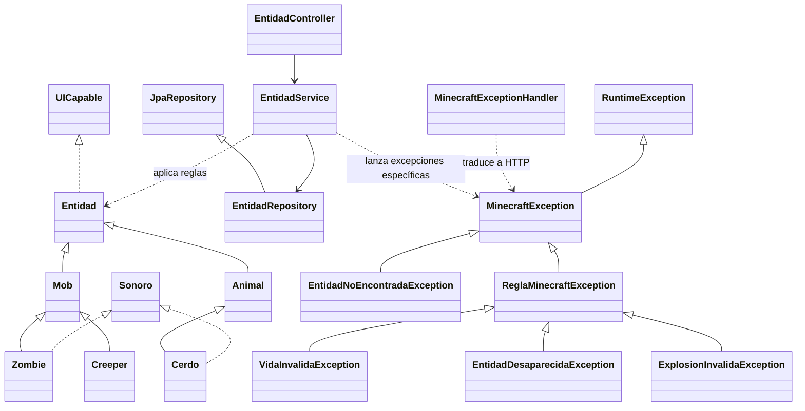

# Minecraft — Lenguaje de Programación 3

Trabajo práctico de Marcelo Romero (`mnri1904`), comisión CYT646 F. API REST en
Spring Boot para crear entidades de Minecraft y simular una explosión. Usa Java 21,
Spring Data JPA y H2. [Consigna de POO-08](https://github.com/alefq/afq-taller-git-2024/blob/main/docs/ejercicio-poo-08-crud-h2-insomnia-2026-10-28.md).

## Guía rápida

Desde la raíz del proyecto, con JDK 21:

```bash
./mvnw test
./mvnw spring-boot:run
```

Abrir <http://localhost:8080/>. La base de desarrollo se conserva entre reinicios;
las pruebas usan otra base H2 en memoria. Ver también la [guía de ejecución](RUN.md).

## POO-09: mapa del grupo para la entrega de Marcelo

| Rol | Estudiante | URL base | URL del documento OpenAPI | Reglas de su API |
| --- | --- | --- | --- | --- |
| A1 | Marcelo Romero | `http://localhost:8080` (desarrollo local) | [OpenAPI 3](http://localhost:8080/openapi.json) | El daño de la explosión disminuye con la distancia. El Creeper desaparece al explotar y no puede volver a detonar. |
| A2 | Elias Pont | Por confirmar | Por confirmar | Por confirmar con Elias. |
| A3 | Alexandre Avalos | Por confirmar | Por confirmar | Por confirmar con Alexandre. |

### Cómo consultar el OpenAPI de A1

Con el servicio iniciado, abrir <http://localhost:8080/openapi.json> o importar
esa URL en Insomnia (**Import → URL**). Spring Boot sirve el [documento JSON](src/main/resources/static/openapi.json)
desde `src/main/resources/static/`. Si cambia una ruta, sus datos o sus reglas,
hay que actualizar ese archivo. Leerlo no ejecuta ninguna jugada.

Buscar `detonarCreeper`: allí figuran el método `POST`, la ruta, qué `id` usar
y ejemplos de rechazo. Usar los ejemplos de `crearEntidad` para preparar la
jugada. Desde otra computadora, usar la dirección accesible del servidor en vez
de `localhost`, o clonar esta versión y arrancarla en esa computadora.

## Correcciones de POO-08

La devolución corresponde al [commit evaluado](https://github.com/mnri1904/mnri-taller-git-2026/commit/9c4c35d8a3015a02791f4a5cc0f3a96fd6a0fbcc).

| Observación | Corrección y forma de comprobarla |
| --- | --- |
| Las entidades validaban y lanzaban excepciones. | `EntidadService` valida los datos, comprueba si la entidad sigue activa y aplica el movimiento, el daño y el consumo del Creeper. Las entidades mantienen su estado privado. `ExplosionTest` comprueba el radio, los objetivos válidos y el daño. |
| Un `PUT` podía revivir a un Creeper que ya había explotado. | El servicio lee la fila y rechaza la actualización **antes** de modificar vida o posición. `EntidadControllerTest.putNoReviveAlCreeperNiPermiteUnaSegundaExplosion` verifica dos rechazos y vuelve a leer las tres filas de H2. |
| El README indicaba 18 pedidos y un envío pendiente. | La [colección entregada](insomnia/poo-08-minecraft.json) contiene **20 pedidos**, numerados del 01 al 20. La entrega original fue recibida y evaluada. Las [capturas](docs/EVIDENCIAS_POO_08.md) corresponden a esa entrega. |
| Faltaban tildes y había errores de redacción. | Se revisaron la documentación, los comentarios y los mensajes de la aplicación. El diagrama y la descripción de las reglas reflejan su ubicación en el servicio. |

Para reproducir el caso del profesor, crear un Creeper en `(5,5)`, un Zombie en
`(6,5)` y un Cerdo en `(7,5)` con vida máxima. Detonar el Creeper. Enviar este
`PUT`, sustituyendo `ID` por el identificador del Creeper:

```bash
curl -i -X PUT http://localhost:8080/api/minecraft/entidades/ID \
  -H 'Content-Type: application/json' \
  -d '{"tipo":"Creeper","vida":20,"posicionX":8,"posicionZ":9}'
```

Resultado esperado: `400` con `codigo: ENTIDAD_DESAPARECIDA`. Un `GET` debe
mostrar al Creeper con vida **0** en **(5,5)**. Un segundo intento de explosión
también devuelve `400`; el Zombie sigue con vida **11** y el Cerdo con **4**.
La misma comprobación se puede ejecutar sin tener el servidor levantado:

```bash
./mvnw -Dtest=EntidadControllerTest#putNoReviveAlCreeperNiPermiteUnaSegundaExplosion test
```

**Verificación del 22 de noviembre de 2026:** `./mvnw clean test` pasó las
63 pruebas. Se ejecutaron los 20 pedidos de la colección por HTTP contra Spring
Boot con una base H2 temporal en archivo. Se comprobó la persistencia tras
reiniciar el servidor y se verificó el rechazo del `PUT` con una lectura posterior.

## Recursos REST

Base: `/api/minecraft/entidades`. La URL identifica el recurso; el verbo indica
la operación. H2 genera el `id` de tipo `Long`: no es un índice del listado.

| Método y ruta relativa a la base | Respuesta |
| --- | --- |
| `POST` | `201` y cabecera `Location` con la ruta del recurso |
| `GET` | `200` y lista de entidades persistidas |
| `GET /{id}` | `200` y datos de la entidad |
| `PUT /{id}` | `200` y estado actualizado |
| `DELETE /{id}` | `204` sin cuerpo |
| `GET /sonidos` | `200` y sonidos de entidades vivas que implementan `Sonoro` |
| `POST /{id}/explosion` | `200` y resultado de la simulación; no requiere cuerpo |

POST y PUT requieren los cuatro campos:

```json
{"tipo":"Zombie","vida":20,"posicionX":0,"posicionZ":0}
```

El servicio admite `Zombie`, `Creeper` y `Cerdo` sin distinguir mayúsculas.
El tipo no puede cambiar durante el PUT. La vida solicitada debe estar entre
1 y 20 para un Zombie o Creeper, y entre 1 y 10 para un Cerdo. Las coordenadas
pueden ser negativas. El cliente no asigna el ID ni la vida máxima. Se utiliza
PUT para reemplazar el estado editable completo; no se implementa PATCH.
DELETE borra físicamente la fila. En cambio, desaparecer en el juego deja la
fila con vida 0 para poder consultarla, sin permitir nuevas acciones.

### Dos reglas en una transacción

1. **Daño por proximidad.** `EntidadService.detonarSobre` selecciona Zombies y
   Cerdos vivos a una distancia euclídea de hasta tres bloques en el plano X/Z.
   El daño es `12 - 3 * floor(distancia)`: 12 en el centro, 9 a un bloque, 6 a
   dos y 3 en el borde. El servicio descuenta como máximo la vida restante.
   Los demás Creepers no reciben daño.
2. **Consumo del detonador.** El servicio exige que el Creeper esté vivo, lo
   carga y finalmente lo consume: queda descargado y con vida 0, incluso si no
   había objetivos. Las dos reglas se ejecutan dentro de `explotar(id)`, en
   una transacción. El resultado incluye `creeperId`, `creeper`, `radio` y
   `afectados`, con distancia, daño real y vida anterior y posterior.

### Excepciones

`MinecraftException` hereda de `RuntimeException`. Sus hijas directas son
`EntidadNoEncontradaException` y `ReglaMinecraftException`; esta última agrupa
las tres reglas específicas. Al ser excepciones no comprobadas, no obligan a
declarar `throws` y provocan la reversión de la transacción por defecto.
`MinecraftExceptionHandler` traduce cada tipo a HTTP y devuelve `codigo` y `error`.

| Excepción | HTTP | `codigo` |
| --- | --- | --- |
| `EntidadNoEncontradaException` | 404 | `ENTIDAD_NO_ENCONTRADA` |
| `VidaInvalidaException` | 400 | `VIDA_INVALIDA` |
| `EntidadDesaparecidaException` | 400 | `ENTIDAD_DESAPARECIDA` |
| `ExplosionInvalidaException` | 400 | `EXPLOSION_INVALIDA` |
| `ReglaMinecraftException` | 400 | `REGLA_MINECRAFT_INVALIDA` |

## Recorrido en Insomnia

Importar [`insomnia/poo-08-minecraft.json`](insomnia/poo-08-minecraft.json)
con **Import → File**. Si en Scratch Pad faltan variables, abrir **Ctrl+E →
Base Environment**. Usar `base_url = http://localhost:8080` e
`id_inexistente = 9223372036854775807` como texto. Los demás IDs se obtienen
de las respuestas, no son valores fijos.

| Pedidos | Qué comprobar |
| --- | --- |
| 01–05 | Consultar el índice, crear el Zombie y copiar su ID a `entidad_id`. Listar, consultar y actualizar. Repetir 04: vida 15 en (4,-2), incluso después de reiniciar desde la misma carpeta. |
| 06–08 | El POST de Cerdo con vida 11 devuelve `400`; repetir 03 para comprobar que no creció la lista. Crear un Cerdo válido y consultar los sonidos de ambas familias. |
| 09–11 | Consultar un ID inexistente (`404`), eliminar el Zombie (`204`) y consultar de nuevo (`404`). |
| 12–15 | Crear el Creeper, el Zombie y el Cerdo del escenario. Copiar los dos primeros IDs a `creeper_id` y `zombie_id`. Detonar el Creeper. |
| 16–18 | Consultar el Creeper, intentar detonar otra vez (`400`) y comprobar las vidas finales con el listado. |
| 19–20 | Intentar detonar un Zombie (`EXPLOSION_INVALIDA`) y enviar un POST sin tipo (`REGLA_MINECRAFT_INVALIDA`). |

## Persistencia y diseño

| Propiedad de desarrollo | Valor | Función |
| --- | --- | --- |
| `spring.application.name` | `mnri-taller-git-2026` | Identifica el servicio. |
| `spring.datasource.url` | `jdbc:h2:file:./data/minecraft` | Conserva la base en un archivo local excluido de Git. |
| `spring.datasource.username` | `sa` | Usuario local. |
| `spring.datasource.password` | vacía | Contraseña de desarrollo. |
| `spring.jpa.hibernate.ddl-auto` | `update` | Actualiza el esquema sin recrearlo en cada arranque. |
| `spring.jpa.open-in-view` | `false` | Limita el acceso JPA a la capa transaccional. |
| `spring.h2.console.enabled` | `true` | Habilita la consola local. |
| `spring.h2.console.path` | `/h2-console` | Ruta de la consola. |

En <http://localhost:8080/h2-console> usar la misma URL JDBC y ejecutar
`SELECT * FROM entidades ORDER BY id;`. Las clases comparten ID, vida y posición:
`SINGLE_TABLE` permite consultar toda la familia en una tabla. La columna `tipo`
distingue las clases concretas. El controlador recibe un DTO, no una clase JPA
elegida por el cliente. Spring Data implementa la interfaz `EntidadRepository` y
deriva la consulta `findByVidaGreaterThan` de su nombre. Para cambiar el motor
se revisan el controlador JDBC, la conexión, las migraciones y la generación de
IDs; las reglas del juego no dependen de SQL.



**Sobrecarga:** cada clase concreta admite un constructor sin argumentos y otro
con vida y posición; los primeros delegan con `this(...)`. Los constructores
de las clases base son protegidos. `EntidadService.recibirDanio` admite dos
firmas, con y sin protección. **Sobrescritura:** `Creeper` y `Zombie` implementan
`Mob.atacar()` con la misma firma y distinto mensaje. El servicio invoca el método
mediante una referencia de tipo `Mob`. **Interfaces:** Zombie y Cerdo pertenecen
a familias distintas, pero ambos implementan `Sonoro`. Todas las entidades son
`UICapable`: ofrecen imagen, posición, sonido y velocidad.

Siguen disponibles las demostraciones de POO-06/07:
`GET /api/minecraft/mobs/{tipo}?vida=12&x=3&z=2`,
`GET /api/minecraft/sonidos/{tipo}` y `GET /api/minecraft/ui/{tipo}`.
`/api/minecraft/creeper` opera sobre el Creeper de demostración en memoria;
el CRUD y la simulación persistida usan `/api/minecraft/entidades`.

[Especificaciones de la entrega original](ENTREGA_POO_08_MNRI.md) ·
[Bitácora de IA](BITACORA.md) · [Licencia Apache 2.0](LICENSE)
