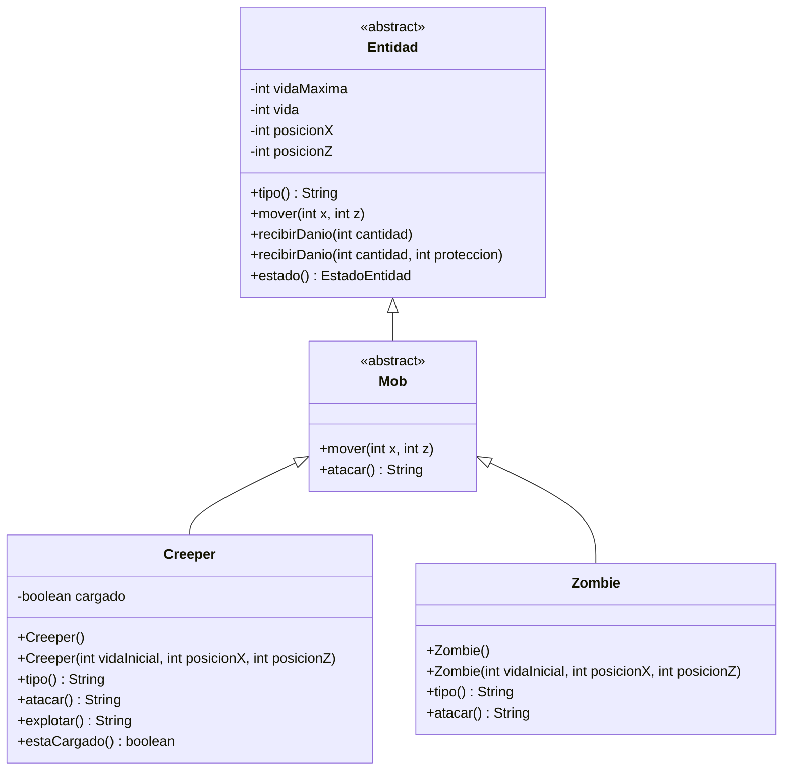

# MNRI Taller Git 2026

Proyecto de Marcelo Nicolas Romero Insfran (`mnri1904`) para la comision CYT646 F.

Continuacion individual POO-06: paquetes, constructores, sobrecarga y
sobreescritura aplicados al dominio Minecraft.

## Licencia

El proyecto se distribuye bajo [Apache License 2.0](LICENSE).

## Organizacion

```text
src/main/java/py/edu/uc/lp3/
├── MnriTallerGit2026Application.java
├── domain/
│   ├── Entidad.java
│   ├── EstadoEntidad.java
│   ├── Mob.java
│   ├── Creeper.java
│   └── Zombie.java
└── rest/controller/
    ├── IndexController.java
    ├── MobController.java
    └── RomeroMarceloController.java
```

El dominio contiene las reglas del juego. Los controllers reciben HTTP y
envian mensajes al dominio. La clase Application inicia Spring Boot.

## Ejecutar

Requisito: JDK 21. Se utiliza Maven Wrapper, por lo que no es necesario
instalar Maven por separado.

```bash
./mvnw spring-boot:run
```

La API queda disponible en `http://localhost:8080`.

## Endpoints

```text
GET /
GET /api/minecraft/mobs/creeper?vida=12&x=100&z=-50
GET /api/minecraft/mobs/zombie?vida=15&x=3&z=2
```

El controller construye el mob indicado en la URL y lo usa mediante el tipo
padre `Mob`. El JSON resultante muestra el estado heredado y el comportamiento
sobreescrito por cada hija.

Los parametros `vida`, `x` y `z` alimentan el constructor. `x` y `z` son
obligatorios; si se omite `vida`, se utiliza 20. Cada peticion a este endpoint
crea una instancia nueva. La vida inicial debe estar entre 1 y 20 y se valida
en `Entidad`. Un valor invalido produce HTTP 400 con un JSON de error.

La posicion inicial es el lugar de aparicion, no un desplazamiento. Por eso
puede estar lejos del origen. El limite de ocho bloques se aplica al mensaje
`mover`, no al constructor.

## Sobrecarga y sobreescritura

### Sobrecarga de constructores

Se agregaron constructores con vida y posicion inicial en `Entidad`, `Mob`,
`Creeper` y `Zombie`. Las hijas ofrecen estas dos formas de construccion:

```java
new Creeper();             // Vida 20, posicion (0, 0)
new Creeper(12, 100, -50);  // Vida y posicion indicadas
new Zombie();
new Zombie(15, 3, 2);
```

El constructor sin argumentos delega con `this(...)`. El constructor con
argumentos llama a `super(...)`; la validacion comun se concentra en
`Entidad`. Ninguna firma permite crear una entidad con vida inicial invalida.

### Sobrecarga de un mensaje

En `Entidad` se mantienen dos firmas de la misma accion:

```java
entidad.recibirDanio(8);     // Recibe 8 puntos
entidad.recibirDanio(8, 3);  // Proteccion de 3: recibe 5 puntos
```

La segunda firma descuenta la proteccion sin curar al objeto: si absorbe todo
el danio, la vida no cambia. Rechaza proteccion negativa y danio no positivo.
Cuando queda danio efectivo, delega en la primera firma para conservar las
reglas de vida y desaparicion. Ambas firmas se heredan en las dos hijas.

### Sobreescritura y polimorfismo

`Mob` declara `public abstract String atacar()`. `Creeper` y `Zombie` lo
sobreescriben con `@Override`, manteniendo la misma firma:

- `Creeper.atacar()` carga su explosion.
- `Zombie.atacar()` realiza un ataque cuerpo a cuerpo.

`MobController` invoca `atacar()` mediante una referencia `Mob`; el texto de
la respuesta JSON sale de la implementacion de cada hija. Ambas tambien
implementan `tipo()`, declarado abstracto en `Entidad`. `Mob.mover(...)`
sobreescribe el movimiento para limitarlo y luego llama a `super.mover(...)`.

**Diferencia:** sobrecarga es el mismo nombre con distintos argumentos en una
clase; sobreescritura es la misma firma implementada por una clase hija.

## Ocultamiento e invariantes

La vida, vida maxima, posicion y carga son privadas. El controller no asigna
esos campos: construye objetos y les envia mensajes. `EstadoEntidad` es un
record inmutable para exponer el estado. El danio nunca deja vida negativa,
una entidad desaparecida no puede atacar y el Creeper debe cargar antes de
explotar. Si el controller pudiera asignar vida directamente, podria saltarse
estas reglas; por eso no se exponen campos publicos ni setters de vida.

## Como probar

Pruebas automatizadas:

```bash
./mvnw test
```

Con el servicio iniciado en otra terminal:

```bash
curl http://localhost:8080/
curl "http://localhost:8080/api/minecraft/mobs/creeper?vida=12&x=100&z=-50"
curl "http://localhost:8080/api/minecraft/mobs/zombie?vida=15&x=3&z=2"
curl -i "http://localhost:8080/api/minecraft/mobs/zombie?vida=21&x=0&z=0"
```

Los dos mobs devuelven `entidad` y `comportamiento`; la ultima consulta devuelve
HTTP 400. Para observar ambas firmas de danio en el recurso persistente del
Creeper, reiniciarlo primero:

```bash
curl -X POST http://localhost:8080/api/minecraft/creeper/reiniciar
curl -X POST http://localhost:8080/api/minecraft/creeper/danio -H "Content-Type: application/json" -d '{"cantidad":4}'
curl -X POST "http://localhost:8080/api/minecraft/creeper/danio?proteccion=3" -H "Content-Type: application/json" -d '{"cantidad":8}'
```

La vida pasa de 20 a 16 y luego a 11. La proteccion representa puntos
absorbidos en ese golpe, no un porcentaje ni una armadura persistente.

## Diagrama de clases



La consigna del taller esta en
[alefq/afq-taller-git-2024](https://github.com/alefq/afq-taller-git-2024/blob/main/docs/TALLER_GIT.md).

Enunciado de esta continuacion:
[POO-06](https://github.com/alefq/afq-taller-git-2024/blob/main/docs/ejercicio-poo-06-revision-paquetes-constructores-2026-09-30.md).

El uso de asistencia de IA se registra en [BITACORA.md](BITACORA.md).
