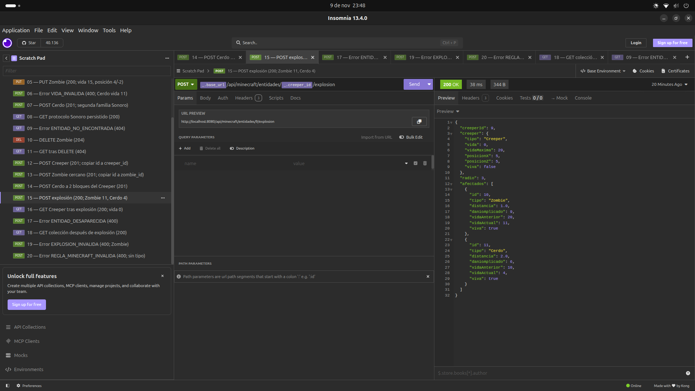
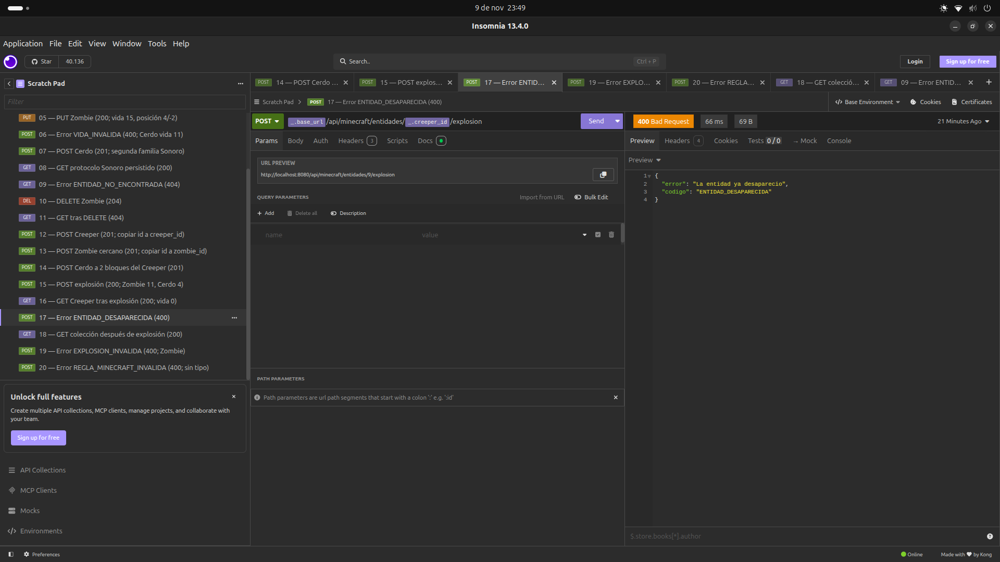
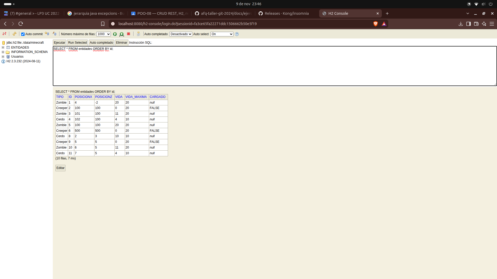
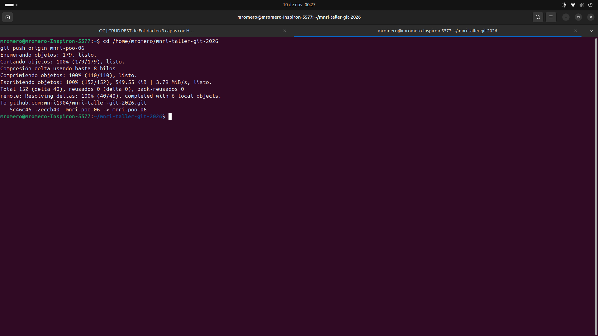

# Registro de verificación manual — POO-08

## Origen y alcance

Este registro se redacta a partir de las capturas y salidas de terminal que
el estudiante compartió durante la sesión. Se usó Insomnia Desktop **13.4.0**
en Ubuntu, Spring Boot en `http://localhost:8080` y la consola H2 del servicio.

Las capturas compartidas en el chat se usaron para esta transcripción. Las
imágenes guardadas posteriormente en `docs/evidencias/` se insertan debajo
de la verificación correspondiente.
Los IDs corresponden a esa ejecución: una nueva prueba debe usar los IDs que
devuelva su propia base. No se modificaron filas directamente desde H2.

## CRUD, validación y protocolo

| Prueba observada | Resultado visible |
| --- | --- |
| Pedido 01: GET `/` | 200, proyecto MNRI Taller Git 2026 y dominio Minecraft. |
| Pedido 02: crear Zombie | 201, ID 7, vida 20 y posición (0,0). |
| Pedido 04: consultar ID 7 | 200, coincide con el objeto creado. |
| Pedido 05 y GET posterior | ID 7 con vida 15 y posición (4,-2). |
| GET después del reinicio indicado al estudiante | ID 7 mantiene vida 15 y posición (4,-2); la captura confirma el estado tras el reinicio reportado. |
| Pedido 03, pedido 06 y pedido 03 nuevamente | POST inválido da 400/VIDA_INVALIDA; ambas capturas de la lista muestran respuesta de 660 B y los mismos registros visibles. |
| Pedido 07 y pedido 08 | Cerdo creado con ID 8; la lectura Sonoro devuelve juntos mensajes de Zombies y Cerdos persistidos. |
| Pedido 10: borrar ID 7 | 204 No Content, cuerpo vacío. |
| Pedido 11: consultar ID 7 borrado | 404/ENTIDAD_NO_ENCONTRADA. |

La comparación visual del listado se complementa con las pruebas de integración:
se parte de una tabla vacía y se comprueba con `repository.count()` que sigue
vacía después del POST inválido.

## Simulación con tres clases

Se crearon estas instancias mediante REST:

| Clase | ID | Posición X/Z | Vida inicial |
| --- | --- | --- | --- |
| Creeper | 9 | (5,5) | 20 |
| Zombie | 10 | (6,5) | 20 |
| Cerdo | 11 | (7,5) | 10 |

El pedido 15 ejecutó `POST /api/minecraft/entidades/9/explosion` y devolvió 200:

- Creeper 9: vida 0, `viva=false`.
- Zombie 10: distancia 1, daño aplicado 9, vida final 11.
- Cerdo 11: distancia 2, daño aplicado 6, vida final 4.
- Radio informado: 3.

El pedido 18 hizo un GET independiente de la colección y mostró las mismas
vidas finales, confirmando que no era solo un cálculo temporal de respuesta.
El pedido 17 intentó repetir la explosión: 400/ENTIDAD_DESAPARECIDA.

Esto muestra las dos reglas: daño dependiente de proximidad y consumo del
detonador, que queda desaparecido e impedido de actuar en ese estado.

### Captura de la explosión en Insomnia



## Un error por cada tipo atendido

| Pedido | Caso | HTTP | `codigo` observado |
| --- | --- | --- | --- |
| 06 | Cerdo con vida 11 | 400 | `VIDA_INVALIDA` |
| 09 | ID 9223372036854775807 inexistente | 404 | `ENTIDAD_NO_ENCONTRADA` |
| 17 | Detonar otra vez al Creeper 9 | 400 | `ENTIDAD_DESAPARECIDA` |
| 19 | Intentar detonar al Zombie 10 | 400 | `EXPLOSION_INVALIDA` |
| 20 | POST con cuerpo `{}` | 400 | `REGLA_MINECRAFT_INVALIDA` |

### Captura del error al repetir una explosión



## Observación directa en H2

Se conectó la consola a `jdbc:h2:file:./data/minecraft` y se ejecutó solo lectura:

```sql
SELECT * FROM entidades ORDER BY id;
```

La captura final muestra **10 filas** con IDs 1, 2, 3, 4, 5, 6, 8, 9, 10 y 11.
El ID 7 no está porque se borró mediante DELETE. Las filas de la simulación
confirman Creeper 9 con vida 0 y `CARGADO=FALSE`, Zombie 10 con vida 11 y
Cerdo 11 con vida 4. El discriminador `TIPO` diferencia las tres clases en la
misma tabla. `CARGADO` es `null` en Zombie/Cerdo porque es un atributo exclusivo
de Creeper en el esquema `SINGLE_TABLE`.

### Captura de la tabla H2



## Importación en Scratch Pad

Los 20 pedidos se importaron, pero el entorno apareció vacío. Se configuraron
manualmente las variables con Ctrl+E y filas tipo Text:

| Variable | Valor de esta ejecución |
| --- | --- |
| `base_url` | `http://localhost:8080` |
| `entidad_id` | `7` (borrado al finalizar el CRUD) |
| `creeper_id` | `9` |
| `zombie_id` | `10` |
| `id_inexistente` | `9223372036854775807` |

Para repetir desde otra base, reemplazar los IDs luego de cada creación.
La colección versionada conserva valores iniciales de ejemplo, no estos IDs
como requisito de ejecución.

## Publicación realizada por el estudiante

El estudiante ejecutó personalmente:

```bash
cd /home/mromero/mnri-taller-git-2026
git push origin mnri-poo-06
```

La terminal confirmó el envío de los ocho commits a su rama, sin modificar
`main`: `5c46c46..2eccb40  mnri-poo-06 -> mnri-poo-06`.

Commit de la solución publicada:
https://github.com/mnri1904/mnri-taller-git-2026/commit/2eccb407d30bafbd0b8ba630c6fd398336aaaa06

Esta captura y su registro se incorporaron posteriormente en el commit `9c4c35d`.


